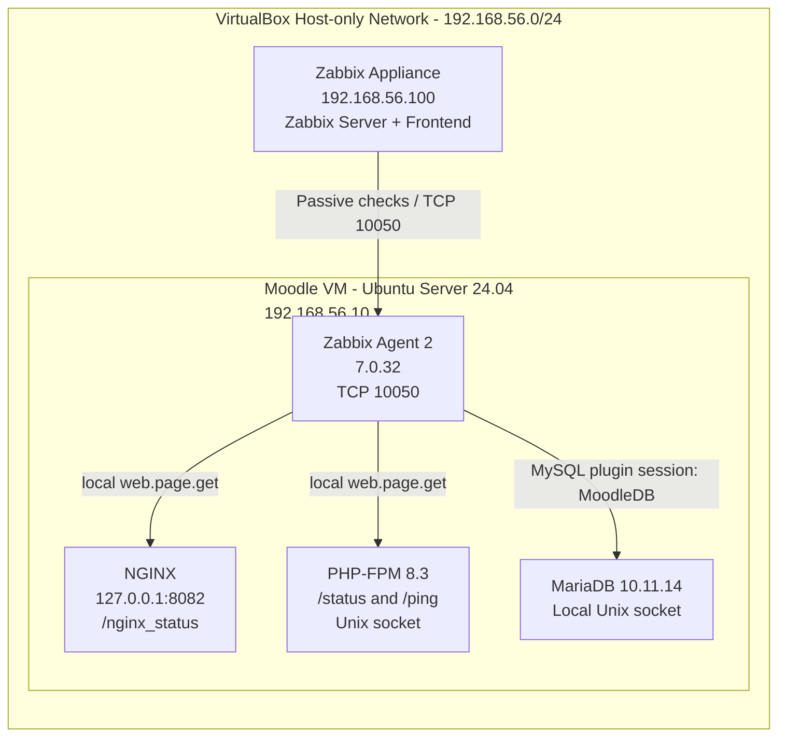

# Moodle Infrastructure Monitoring with Zabbix 7.0

A hands-on academic lab that monitors a Moodle web server with **Zabbix 7.0**, **Zabbix Agent 2**, **NGINX**, **PHP-FPM**, and **MariaDB**.

> **Project type:** VirtualBox lab / academic portfolio project  
> **Current scope:** One monitored Moodle server  
> **Status:** Core Linux, NGINX, PHP-FPM, and MariaDB data collection configured and verified

## Overview

The goal of this project is to build a centralized monitoring setup for a Moodle server and verify that infrastructure and application-level metrics reach Zabbix. The Zabbix server polls Zabbix Agent 2 on the Moodle VM. The agent retrieves local service information from NGINX, PHP-FPM, and MariaDB without exposing their monitoring endpoints to the host-only network.

### Lab architecture



The monitoring endpoints are bound to loopback (`127.0.0.1`). They are queried locally by the agent; they are not intended to be reachable from other VMs.

## Environment

| Component | Lab details |
|---|---|
| Hypervisor | VirtualBox |
| Virtual network | Host-only, `192.168.56.0/24` |
| Zabbix appliance | `192.168.56.100`, Zabbix 7.0 series |
| Moodle VM | Ubuntu Server 24.04, `192.168.56.10` |
| Zabbix Agent 2 | 7.0.32 |
| Agent hostname | `Moodle-server` |
| Web server | NGINX with `stub_status` |
| PHP runtime | PHP 8.3-FPM (`php8.3-fpm`) |
| Database | MariaDB 10.11.14 |

## Monitoring coverage

The following templates are linked to the `Moodle-server` host in the Zabbix frontend:

- **Linux by Zabbix agent**: operating-system metrics such as CPU, memory, filesystems, and network activity.
- **Nginx by Zabbix agent**: NGINX status and connection/request metrics.
- **PHP-FPM by Zabbix agent**: PHP-FPM pool status, worker counts, queue, and process metrics.
- **MySQL by Zabbix agent 2**: MariaDB availability, version, and database statistics through the Agent 2 MySQL plugin.

Template item names and discovery results can vary slightly with the installed Zabbix template revision.

## Key configuration decisions

### Agent access

The Moodle agent is configured with the following core settings:

```ini
Server=192.168.56.100
ServerActive=192.168.56.100
Hostname=Moodle-server
ListenIP=192.168.56.10
```

The host name must match the host name registered in the Zabbix frontend for active checks. The agent listens on the Moodle VM's host-only address, not on every interface.

### NGINX status

NGINX exposes its status page on a local-only listener:

- Listener: `127.0.0.1:8082`
- Path: `/nginx_status`
- Module: `stub_status`

### PHP-FPM status

The PHP-FPM `www` pool enables:

```ini
pm.status_path = /status
ping.path = /ping
```

The endpoints are passed through the local NGINX monitoring server to the PHP-FPM socket:

`/run/php/php8.3-fpm.sock`

### MariaDB monitoring

A dedicated account, `zbx_monitor@localhost`, is used by the Agent 2 MySQL plugin. The plugin uses a named session called `MoodleDB` and connects through the local MariaDB Unix socket:

`/run/mysqld/mysqld.sock`

The MariaDB password is stored only in the local Agent 2 plugin configuration and is intentionally not included in this repository.

## Verification performed

The following checks were completed during implementation:

| Check | Result |
|---|---|
| Zabbix appliance to Moodle agent: `agent.ping` | Returned `1` |
| NGINX local status endpoint | HTTP `200 OK` |
| NGINX status retrieved through Agent 2 `web.page.get` | HTTP `200 OK` and status output |
| PHP-FPM ping endpoint | Returned `pong` |
| PHP-FPM status endpoint | Returned JSON pool statistics |
| PHP-FPM process discovery | Found `php-fpm8.3` |
| MariaDB plugin `mysql.ping[MoodleDB]` | Returned `1` after credentials were synchronized |
| MariaDB plugin `mysql.version[MoodleDB]` | Returned `10.11.14-MariaDB-0ubuntu0.24.04.1` |
| Zabbix Latest data | Linux, NGINX, PHP-FPM, and MySQL items visible for `Moodle-server` |

## Repository structure

```text
moodle-zabbix-monitoring/
├── README.md
├── PUBLISHING.md
├── .gitignore
├── configs/
│   ├── mysql-plugin.conf.example
│   ├── nginx-status.conf.example
│   ├── php-fpm-pool.conf.example
│   └── zabbix-agent2.conf.example
├── docs/
│   ├── architecture.mmd
│   ├── deployment-and-verification.md
│   ├── security-notes.md
│   └── troubleshooting.md
└── screenshots/
    └── README.md
```

## Reproduce the lab

1. Create a host-only VirtualBox network using the `192.168.56.0/24` subnet.
2. Deploy the Zabbix 7.0 appliance at `192.168.56.100` and the Ubuntu Server 24.04 Moodle VM at `192.168.56.10`.
3. Install Zabbix Agent 2 on the Moodle VM and configure its host name, allowed server, and listen address.
4. Link the Linux agent template and verify passive connectivity with `zabbix_get`.
5. Enable NGINX `stub_status` on a loopback-only listener and link **Nginx by Zabbix agent**.
6. Enable PHP-FPM pool status and ping paths, proxy them through the local NGINX listener, and link **PHP-FPM by Zabbix agent**.
7. Create a dedicated local MariaDB monitoring account, configure the Agent 2 MySQL plugin named session, and link **MySQL by Zabbix agent 2**.
8. Verify the resulting metrics in **Monitoring → Latest data**.

See [`docs/deployment-and-verification.md`](docs/deployment-and-verification.md) for the command-level checklist and [`docs/security-notes.md`](docs/security-notes.md) for publication and hardening considerations.

## Lessons learned

- A service can be healthy locally while its monitoring integration is still misconfigured; test every layer independently.
- A PHP-FPM directive prefixed by `;` is commented out and therefore inactive.
- NGINX `location` blocks must be placed at the correct level within the `server` block; accidentally nesting a location caused configuration validation to fail.
- The NGINX template's configured status path must match the actual endpoint (`/nginx_status`).
- Credentials in MariaDB and the Agent 2 plugin configuration must match exactly. The `mysql.ping` and `mysql.version` keys were used to verify the fix.
- Monitoring endpoints and database credentials should remain local and restricted; they do not need to be exposed to the lab network.

## Current limitations and next steps

This repository documents the monitoring configuration and tests completed in the lab. It does **not** claim a production deployment or a completed alerting exercise.

Recommended next improvements:

- Build a focused Zabbix dashboard for Moodle's host and service metrics.
- Configure and test triggers for service availability, disk usage, CPU/memory pressure, PHP-FPM queue growth, and database availability.
- Configure an alert media type and demonstrate a controlled test notification.
- Add sanitized screenshots from the Zabbix frontend.
- Record baseline measurements and observe the system under a controlled workload.

## Screenshots

Place sanitized Zabbix frontend screenshots in [`screenshots/`](screenshots/). Suggested evidence is listed in [`screenshots/README.md`](screenshots/README.md).

## Disclaimer

This is an educational lab running on a private VirtualBox host-only network. Configuration examples are provided for learning and must be reviewed and adapted before use in another environment. Do not publish secrets, private keys, Moodle user data, database dumps, or unredacted logs.

## License

No license has been selected yet. Choose a license before inviting others to reuse or redistribute this material.
